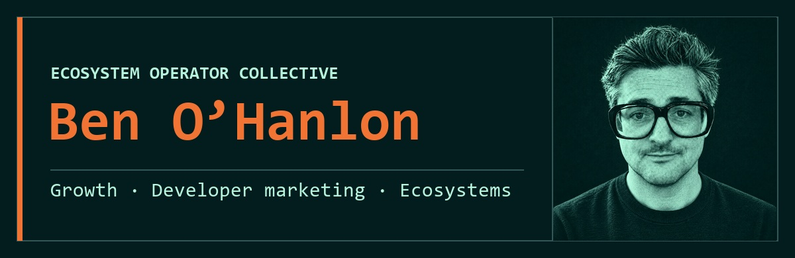

# The Ecosystem Operator Collective

An independent consultancy led by Ben O’Hanlon. We help projects grow by working out what their team should own, what it can do with partners, and what others in the ecosystem can learn to run for themselves.

**[Read benohanlon.md](benohanlon.md)** · [Download the Markdown](https://raw.githubusercontent.com/benohanlon/ecosystem-operator-collective-public/main/benohanlon.md) · [Résumé](https://my.visualcv.com/growth/)

- [Cases](cases/README.md) · How we’ve approached growth, adoption and distribution.
- [EOS Playbook](eos-playbook/README.md) · How ecosystem capabilities, services and packages fit together.
- [Writing](writing/README.md) · Essays that show how we think.
- [Projects](projects/README.md) · Sovereign Harness and other work in progress.
- [Reading list](lists/README.md) · The books and ideas we return to.

[Get in touch with Ben](https://www.linkedin.com/in/memetics/).

## Maintain the public profile

Edit `benohanlon.md` and run `node scripts/build-profile.cjs` to regenerate the homepage and the prompt on the adventure page. Run `node scripts/build-profile.cjs --check` before publishing to check both against the Markdown.
